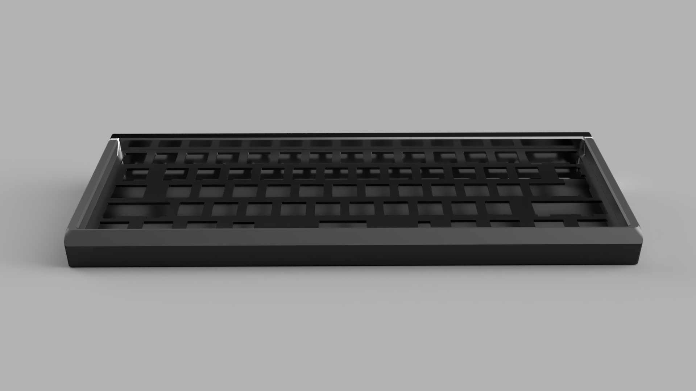
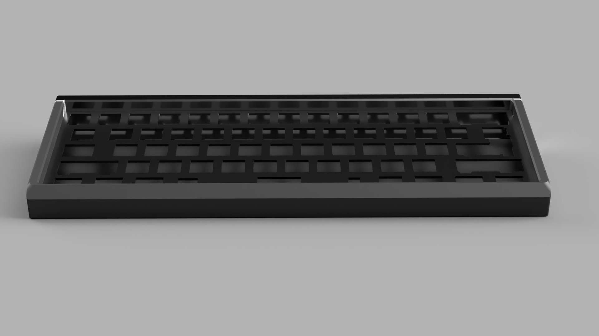
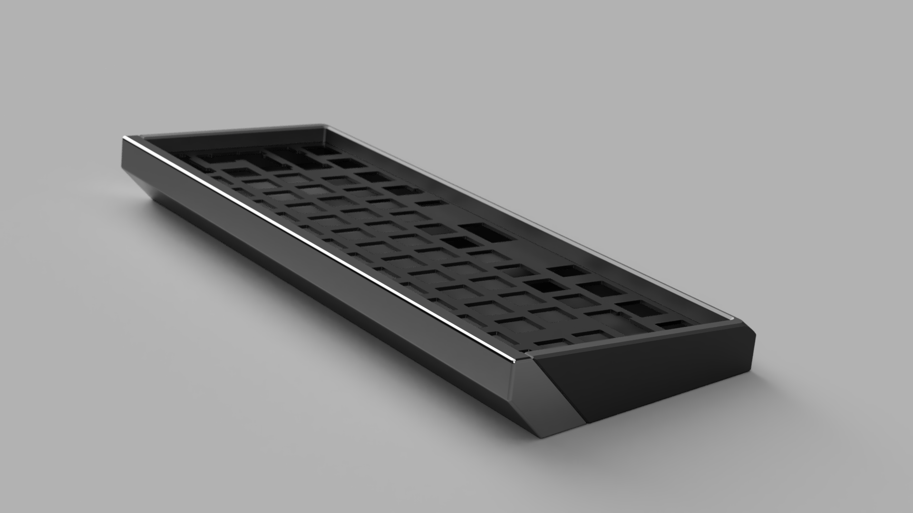
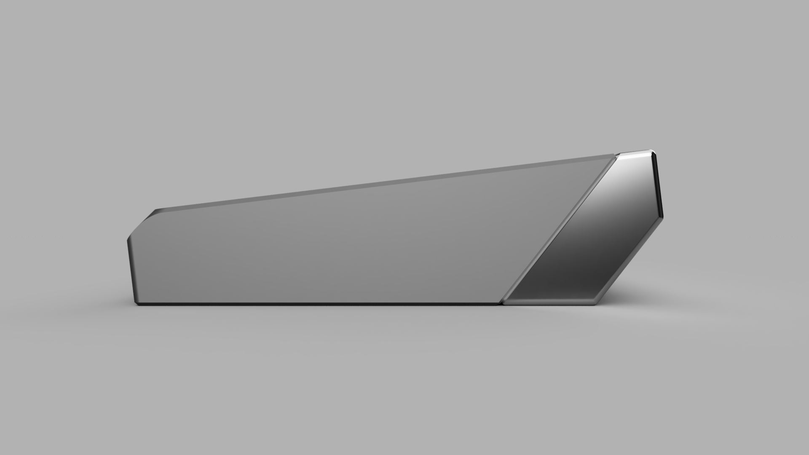

# Toblero60

**A Toblerone-inspired 60% mechanical keyboard case. Modeled and rendered, but never produced — the idea was shelved.**

Toblero60 was a 60% keyboard case with a Toblerone theme. 3D models were built and rendered (Aug 2023), but the project was never produced and the idea was shelved.

## Status

- **Not completed / never produced.** 3D models and renders exist, but no manufacturing or production ever happened.
- The idea was born in a dream / late-night conversation (Aug 2023) and never got funded or built.

## Specs

| | |
|---|---|
| **Layout** | 60% |
| **Construction** | 2-piece sandwich case |
| **Case material (planned)** | CNC-machined aluminum, anodized, with polished accent |
| **Mounting** | DZ60 support |
| **Signature mechanism** | The plate slid in from the top of the case — an unusual / "weird" mounting mechanism was a core part of the appeal |
| **Theme** | Toblerone |

> "simple sandwich 60 tapi surprise aneh/keren pokoknya" — the pitch was a simple 60% sandwich with a weird/cool surprise element.

## Development

- **CAD / modeling:** 3D models were built (Fusion 360, v1) and rendered Aug 24, 2023 — see `rendering/`
- **Production:** never happened — the idea was shelved

- The design was discussed in Aug 2023; the team's reaction was "the weirder it gets, the more interesting it is" — the unusual mounting mechanism was the intended hook.
- A reference on undercut machining (WayKen, *Undercut Machining: A Complete Guide for CNC Parts with Undercuts*) was collected, presumably for the top-slip-in plate mechanism.
- The project was never funded ("tapi gada duit juga wkwkwkw") and was shelved after the v1 models and renders.

## Gallery

Renders of the v1 model (Aug 24, 2023). The case shows the Toblerone-style angled/wedge end caps and the 60% key layout.

Top-down view of the case with key openings:

Front view:

Isometric view showing the wedge end caps:

Side profile — the Toblerone wedge shape:

## References

- [Undercut Machining: A Complete Guide for CNC Parts with Undercuts — WayKen](https://waykenrm.com/blogs/undercut-machining-for-cnc-machined-parts/)

## Source material

- Chat log (Aug 21, 2023) — see `sources/chat-log-2023-08-21.md`
